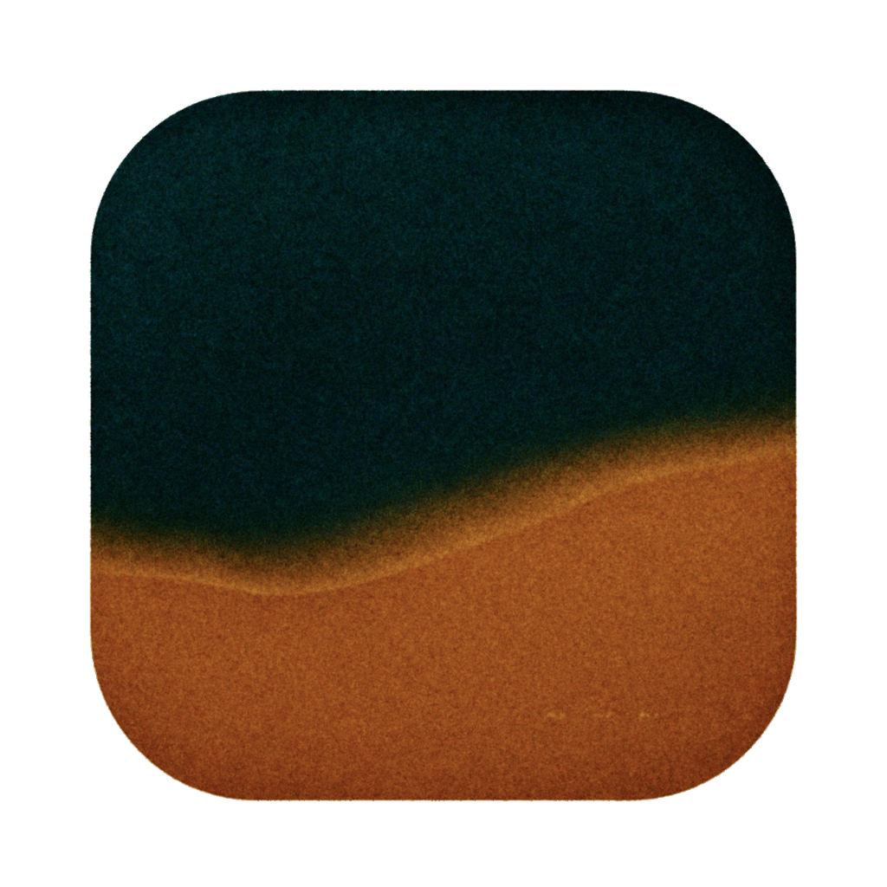
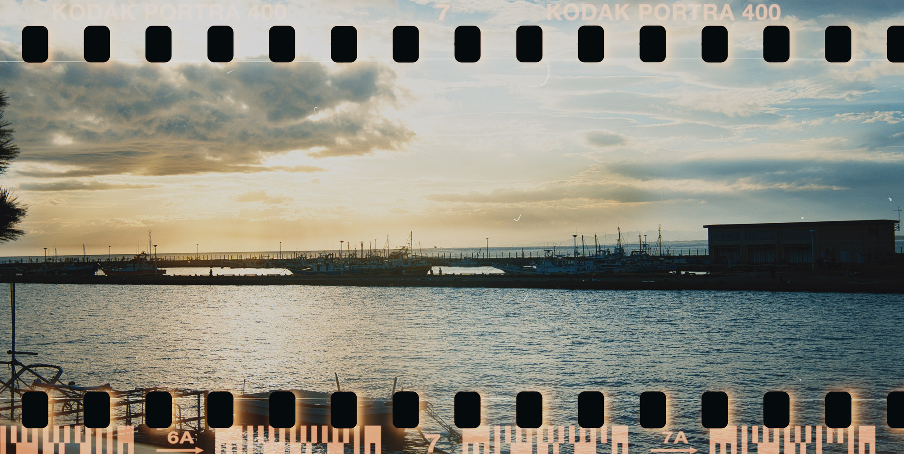
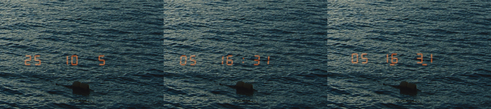
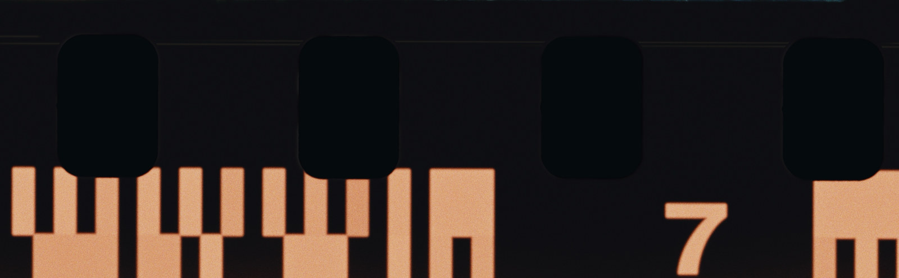
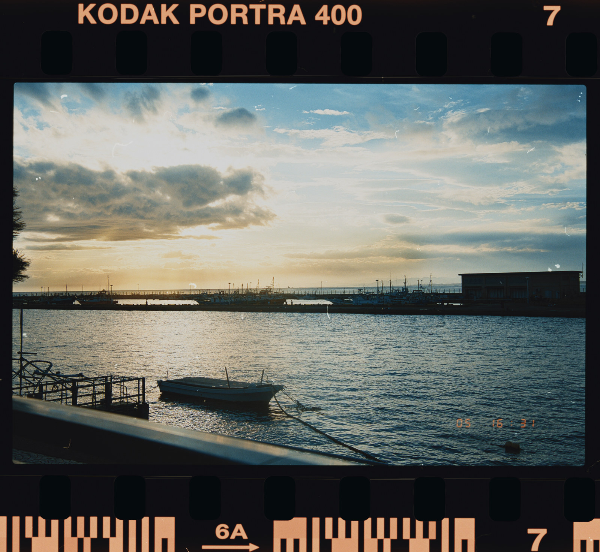
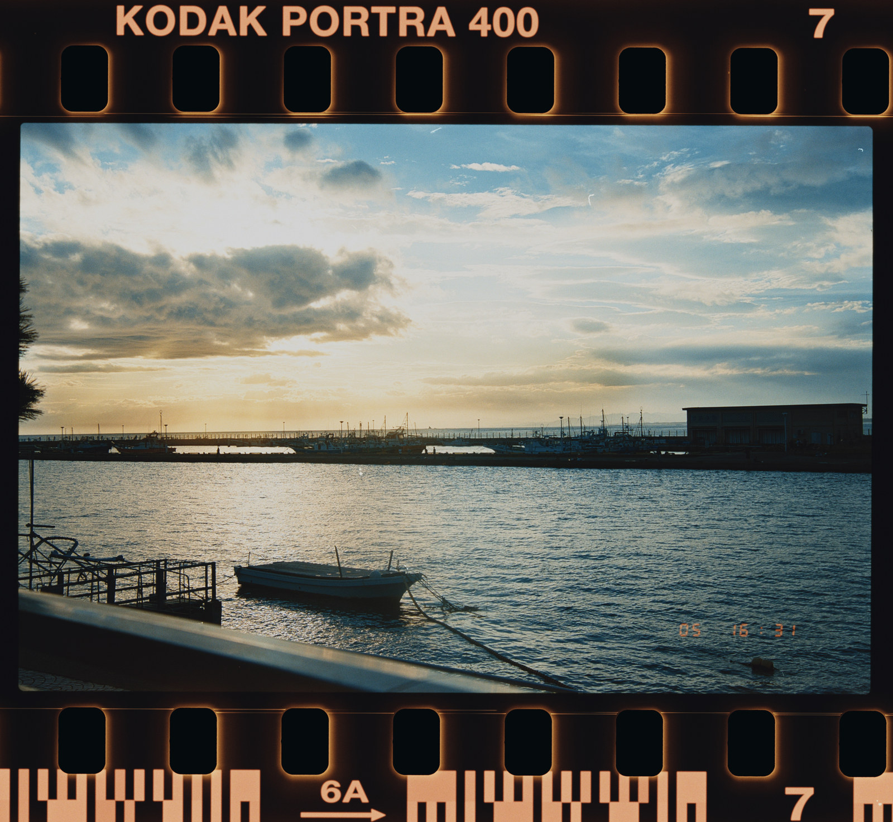
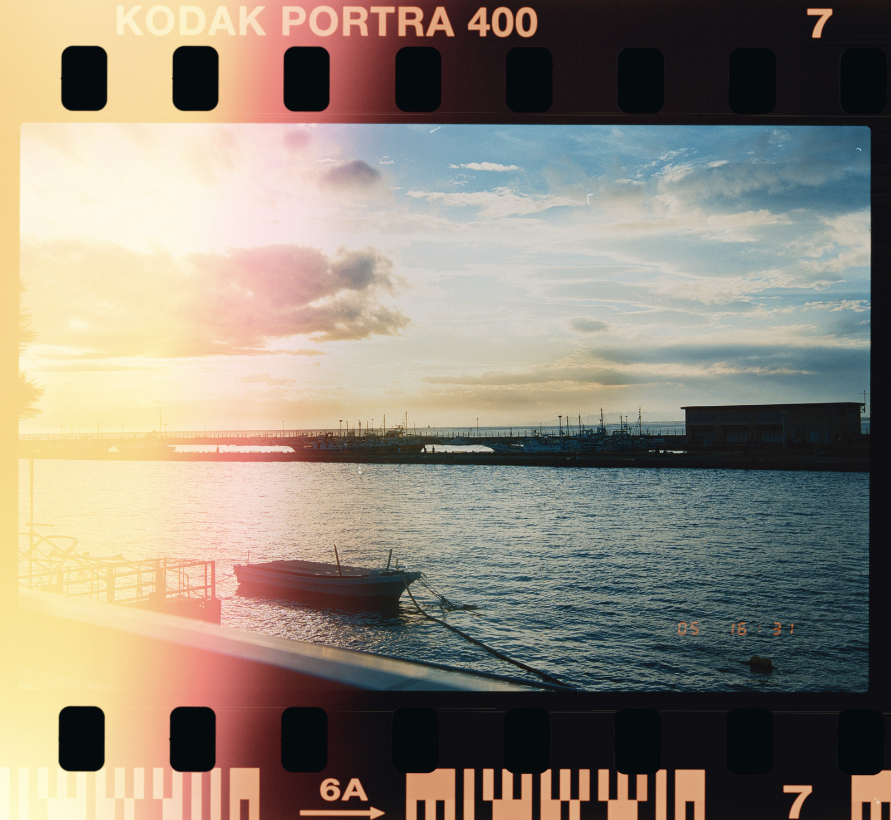

<p align="center">
  
</p>
<h1 align="center">FrameMatter</h1>

[简体中文](README.md)

FrameMatter is an open-source fork of [SpektraLab](https://github.com/JamesQiu2005/SpektraLab) by **Hanze Qiu**. It retains the original application's main interface and interactions, adding controls for grain, date backs, dust and light leaks. The film imaging model comes from [spektrafilm](https://github.com/andreavolpato/spektrafilm) by **Andrea Volpato**.

The upstream application provides the spectral film/print pipeline, native C++/Metal engine, film and paper profiles, RAW workflow, half-frame pairs, export, CLI and MCP access. FrameMatter retains those foundations and adds controls for grain, date imprints and the physical appearance of a film strip.

## Added in FrameMatter

- **Grain controls:** strength, particle area and softness, exposing the existing spektrafilm grain model.
- **Date Back:** four DSEG7 LCD fonts, alongside the dot-matrix face; additional date/time formats, manually set date/time, field spacing, size and brightness controls. The 135 inset follows the picture corner-to-center diagonal, excluding the film border. Year/month/day/hour/minute/second printing is restricted to between-frame placement. Day/hour/minute can use a colon or the reference-style underlines.
- **Scratches & Dust:** sprocket-friction scratches and perforation-edge wear. Negative-scan dust uses **112 real grayscale masks: 64 particles, 32 short fibers and 16 long fibers**. Adjust amount, size, strength, fiber ratio and border-only/whole-film coverage; **Another** changes the saved random pattern. Preview and export share the same pattern.
- **Light Leaks:** an independent left-rail card offers fine perforation rims and soft halos. Each style retains its own strength, spread and random pattern; fine rims also offer coverage and softness. Light and wear switches/seeds are separate; older approved light settings migrate automatically. A separate wide-light group adds 41 bundled material choices grouped by shape, with direction, intrusion, size and softness and a shared natural range through 70% followed by progressive white wash. New settings default to 70% strength; each group stays off until enabled. All textures are included in the repository and release packages.
- **Aging Textures:** an independent card below Scratches & Dust offers five full-frame textures combining accumulated dust, scuffs, long scratches and surface wear. Adjust strength, horizontal/vertical/both-axis mirrors and 0°/90°/180°/270° rotation. Saved per photo, they can coexist with random dust and light leaks without requiring Film Edge. Disabled by default, with 50% strength when enabled. All five textures are included in the repository and release packages.
- **Capture metadata on export:** JPEG, TIFF and PNG exports preserve available camera make/model, lens and exposure data, capture dates and timezone offsets, GPS, authorship, copyright, keywords and ratings where supported. A supplementary reader recovers timezone offsets that ImageIO omits from some RAW files. Dimensions, orientation and ICC describe the finished image; stale source previews and HDR gain maps are excluded. Not every vendor-private field can be retained.
- **Export progress and results:** a dedicated progress window shows a progress bar, current file and completed-image count. Single images use an indeterminate bar; batches show completed frames. The same window then keeps a clear success, notice, failure or stopped result, with filenames, location and written/skipped/failed counts, plus Show in Finder. Results remain until Done is clicked, so even a fast export has an obvious completion signal.
- **Full-width 135 exposure:** a 69.5 × 35 mm / 6×7 preset lets the image reach around and beyond the perforations, with edge markings over the exposed scene. The holes remain empty. Available under panoramic formats.
- **Film-border presentation:** white or near-black hole backing, and indented child controls under subsection headings in the left rail.

### Examples

Full-width 135 exposure (the example also includes perforation light leaks and dust):



Date Back: additional DSEG7 fonts, with hour/minute underlines inspired by the Nikon MF-16 back for the day–hour–minute format, plus formats such as hour–minute–second and year–month–day–hour–minute–second (between frames), inspired by the MF-28 back.



Sprocket scratches and wear (subtle friction marks caused by the inner guide rails during film advance)



Dust and fibers



| Perforation light leaks | Wide light leaks |
|---|---|
|  |  |

## Download and install

Download the DMG from the [releases page](https://github.com/LittleSixNine/FrameMatter/releases/latest), open it, and drag FrameMatter into Applications. The installer requires an Apple silicon Mac running macOS 15 or later.

Current releases use ad-hoc signing and are not notarized by Apple. macOS may block the first launch; only proceed through the system's Privacy & Security prompts after verifying that you trust the download and its source.

## Build and test

Apple silicon, macOS 15+, Xcode 26.6 with the Metal toolchain. From the repository root:

```bash
engine/build.sh bundle
python3 modern_UI/Spektrafilm/Tools/gen-project.py
xcodebuild -project modern_UI/Spektrafilm/Spektrafilm.xcodeproj \
  -scheme Spektrafilm -configuration Debug \
  -derivedDataPath modern_UI/Spektrafilm/build/DerivedData build
```

The app is `modern_UI/Spektrafilm/build/DerivedData/Build/Products/Debug/FrameMatter.app`. The internal target/module remains `Spektrafilm`. Baked resources are tracked; the app uses no Python at runtime. Existing local settings and edit-storage paths are retained for compatibility.

```bash
xcodebuild -project modern_UI/Spektrafilm/Spektrafilm.xcodeproj \
  -scheme SpektrafilmTests -configuration Debug \
  -derivedDataPath modern_UI/Spektrafilm/build/DerivedData test
```

Some tests need external camera fixtures and skip when those files are absent. A green run with skips is not full fixture coverage. See [ARCHITECTURE.md](ARCHITECTURE.md) and [the frontend notes](modern_UI/Spektrafilm/README.md) for implementation details.

[Releases](https://github.com/LittleSixNine/FrameMatter/releases) · [Issues](https://github.com/LittleSixNine/FrameMatter/issues) · [Source](https://github.com/LittleSixNine/FrameMatter)

FrameMatter builds are separate from upstream's installers and do not inherit upstream's Developer ID signature or Apple notarization. CLI/MCP access is off until enabled in Settings → Agents; that panel provides the `framematter` command and current MCP configuration.

## Credits and licenses

FrameMatter additions and modifications: Copyright © 2026 LittleSixNine, licensed under GPL-3.0-or-later. This claim covers only those contributions; upstream code and third-party assets retain their original copyrights, attribution and licences. Historical commits authored by “六九” identify the same contributor as LittleSixNine. See [copyright and contribution scope](COPYRIGHT.txt).

| Contribution | Author / source | License |
|---|---|---|
| Original application, native C++/Metal port and four black-and-white profiles | [Hanze Qiu / SpektraLab](https://github.com/JamesQiu2005/SpektraLab) | GPL-3.0-or-later; profile data retains its notices |
| Film model, measured color profiles and print LUTs | [Andrea Volpato / spektrafilm](https://github.com/andreavolpato/spektrafilm) | Code GPL-3.0-or-later; profiles/LUTs CC BY-SA 4.0 |
| FrameMatter additions | [LittleSixNine](https://github.com/LittleSixNine/FrameMatter) | GPL-3.0-or-later |
| Grayscale dust and fiber scan data | [Daniela Ivanova / Scans of film damage](https://doi.org/10.6084/m9.figshare.21803292) | CC BY 4.0; crops and extraction changes recorded in the bundle |
| Scratch-mask algorithm reference | [FilmDamageSimulator](https://github.com/daniela997/FilmDamageSimulator) | MIT |
| DSEG fonts | [Keshikan / DSEG](https://github.com/keshikan/DSEG) | SIL Open Font License 1.1 |
| Metal C++ bindings | Apple / metal-cpp | Apache-2.0 |

Full license texts and source links are available in **FrameMatter → About FrameMatter** and in the source tree. The README and application use the FrameMatter icon. FrameMatter is an independent derivative and is not an official SpektraLab or spektrafilm release. Git history and upstream attribution are preserved.
