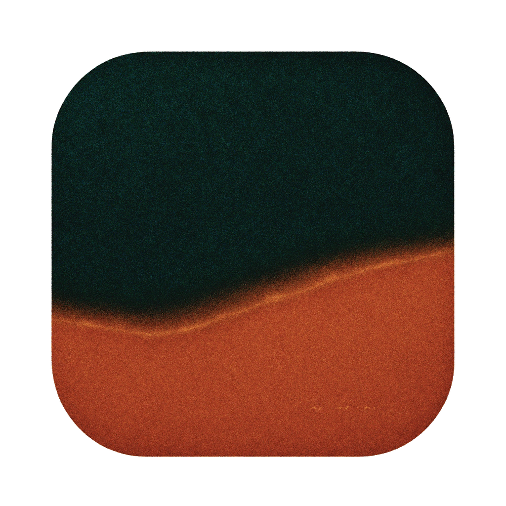
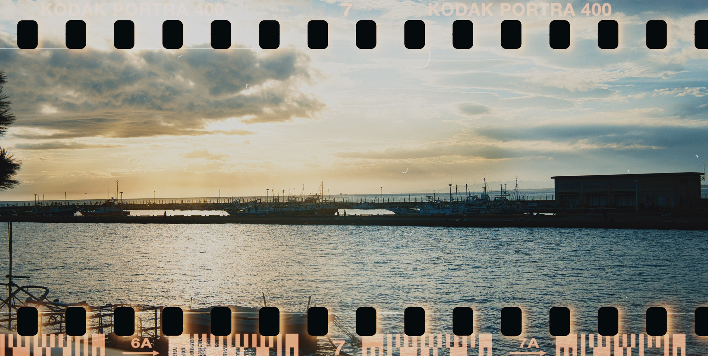
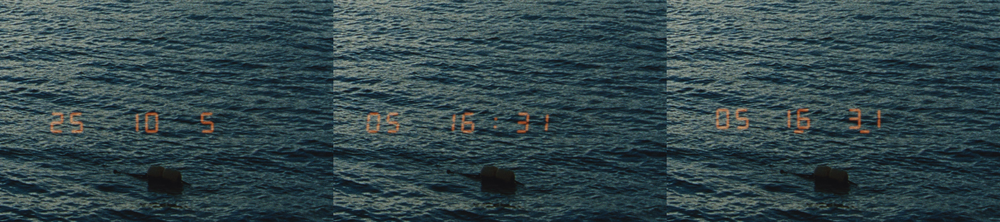
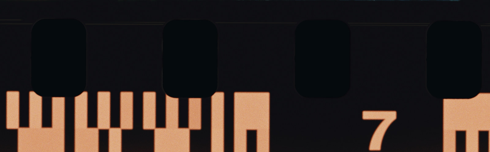
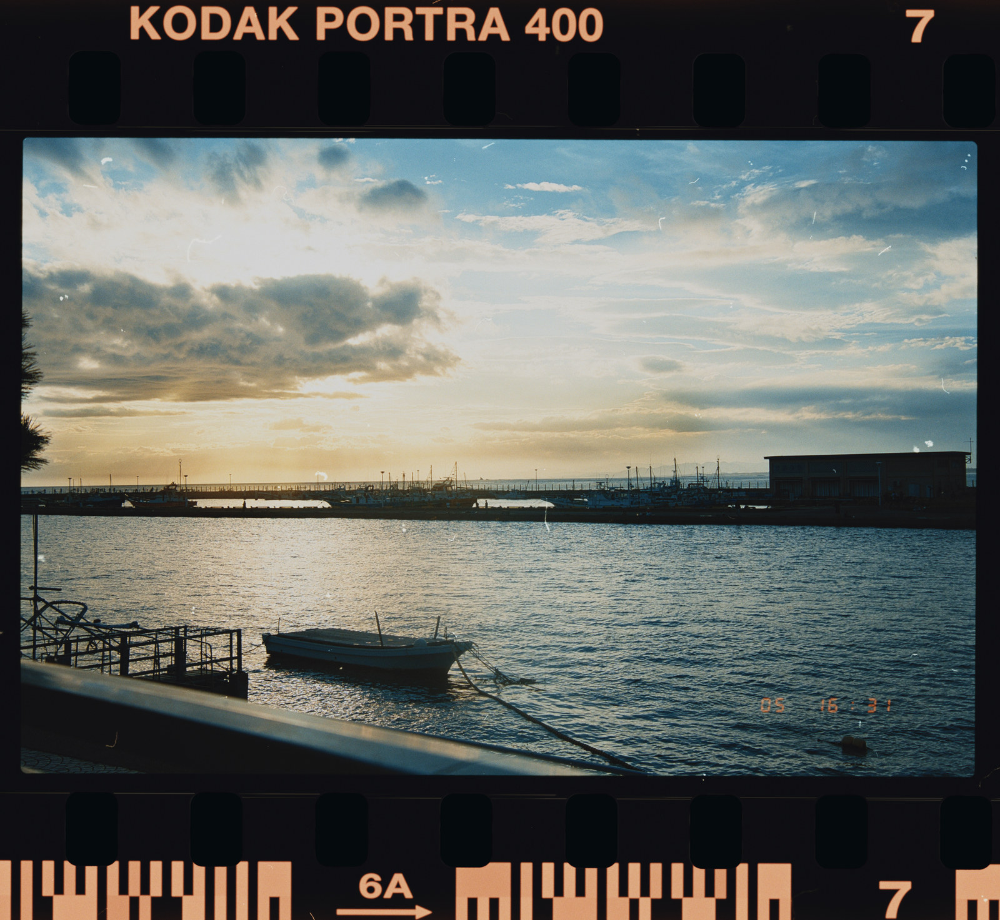
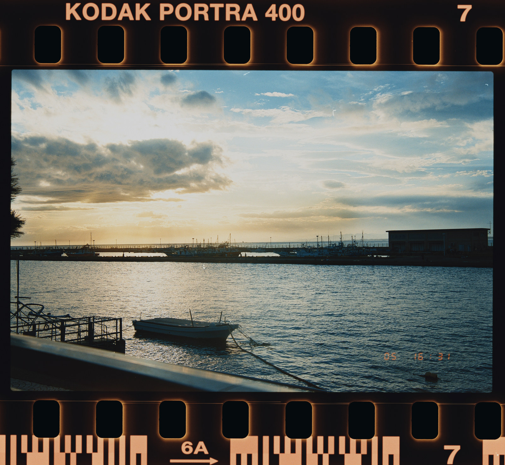
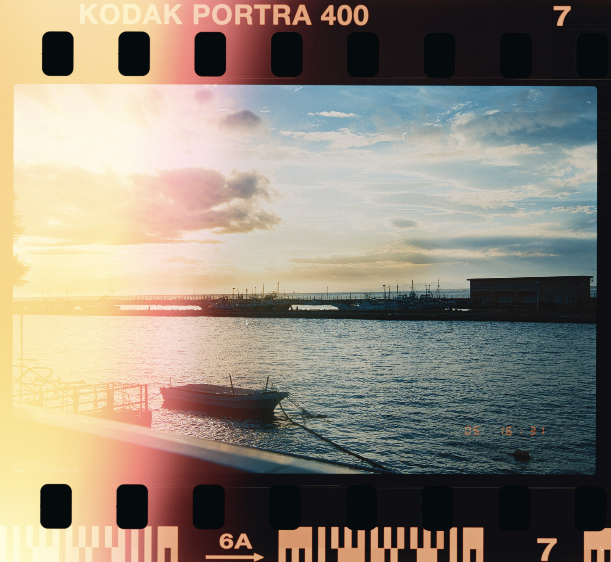

<p align="center">
  
</p>
<h1 align="center">FrameMatter</h1>

[English](README.en.md)

FrameMatter 是基于 **Hanze Qiu** 的 [SpektraLab](https://github.com/JamesQiu2005/SpektraLab) 的开源分支，沿用其主要界面与交互，并增加颗粒、日期后背、灰尘和漏光等功能，胶片成像模型来自 **Andrea Volpato** 的 [spektrafilm](https://github.com/andreavolpato/spektrafilm)。

上游项目提供了光谱胶片／印放流程、原生 C++/Metal 引擎、胶片和相纸配置、RAW 工作流、半格拼接、导出，以及 CLI／MCP 接口。FrameMatter 保留这些基础，增加颗粒、日期打印和胶片边缘外观的调节能力。

## FrameMatter 新增功能

- **颗粒调节**：开放强度、粒子面积与柔和度，沿用 spektrafilm 已有颗粒模型。
- **日期后背**：增加四种 DSEG7 LCD 字体，与原有点阵样式并存；扩展日期／时间格式，支持自设日期和时间，以及字段间距、大小和亮度调节。135 边距沿照片内容角落到中心的对角线移动，不包含片边。年月日时分秒仅支持片间打印；日时分支持冒号或参考样片式下划线。
- **划痕与灰尘**：增加齿孔摩擦划痕与齿孔边缘磨损。负片扫描灰尘使用 **112 份真实灰度素材：64 份尘粒、32 份短纤维、16 份长纤维**。可调数量、大小、强度和纤维比例，范围可选仅片边或全片；“换一组”更换已保存的随机样式，预览与导出沿用同一分布。
- **漏光**：独立的左栏选项卡提供贴孔细亮边与孔外柔晕。两种样式分别保存强度、扩散范围和随机图案，细亮边另有覆盖与柔化。漏光开关、随机种子独立于划痕和灰尘，旧版已采用的漏光参数会自动迁移。另有大范围漏光分组，提供41个本地素材选项，按光形分组，含四张一闪参考素材、方向、侵入范围、大小与柔化，前70%自然叠加、之后逐渐增强冲白；新设置强度默认70%，仍需手动开启；私人素材不进入 Git 或公开发布包。
- **做旧纹理**：在“划痕与灰尘”下方提供独立选项卡，五款整幅纹理呈现积尘、擦痕、长划痕和表面磨损。支持强度、左右／上下／双向镜像及 0°／90°／180°／270° 旋转，可与随机灰尘和漏光同时使用，不依赖开启片边；设置随照片保存。默认关闭，启用强度默认 50%；五款素材仅供本地研究，不随 Git 或公开发布包分发。
- **导出拍摄信息**：JPEG、TIFF、PNG 导出尽量保留相机品牌与型号、镜头与曝光参数、拍摄时间及其时区、GPS，以及可用的作者、版权、关键词和评级。补充读取部分 RAW 中 ImageIO 漏读的时区；尺寸、方向和 ICC 按成品更新，不复制失效的原图预览或 HDR 增益图。厂商私有字段不保证全部保留。
- **导出进度与结果**：导出时显示独立进度窗口，提供进度条、当前文件和已处理数量；单张使用动态进度条，批量显示完成张数。完成后窗口保留明确的成功、提示、失败或停止结果，列出文件名、位置及导出／跳过／失败数量，可在访达中查看；点击“完成”才关闭提示，快速导出也有清晰反馈。
- **135 全宽曝光**：在宽幅格式下增加 69.5 × 35 mm／6×7 模式，照片内容延伸到齿孔之间及外侧，边码叠在曝光画面上，齿孔保持镂空。
- **片边与界面**：支持白色或近黑色齿孔背景；左栏分组内的子设置标签缩进，层级更清楚。


### 效果示例

135 全宽曝光（示例图片除了全宽效果，还添加了齿孔漏光和灰尘）：




日期后背：新增几种 DSEG7 字体，同时针对“日-时-分”格式的后背，支持模拟尼康 MF-16后背的时分下划线，以及 MF-28 后背的“时分秒”“年月日时分秒（片间）”等格式。



齿孔划痕与磨损（过片时内导轨造成的微小摩擦效果）



灰尘与纤维



| 齿孔漏光 | 全片漏光 |
|---|---|
|  |  |


## 构建与测试

环境：Apple silicon、macOS 15 及以上、Xcode 26.6，并安装 Metal 工具链。在仓库根目录执行：

```bash
engine/build.sh bundle
python3 modern_UI/Spektrafilm/Tools/gen-project.py
xcodebuild -project modern_UI/Spektrafilm/Spektrafilm.xcodeproj \
  -scheme Spektrafilm -configuration Debug \
  -derivedDataPath modern_UI/Spektrafilm/build/DerivedData build
```

产物：`modern_UI/Spektrafilm/build/DerivedData/Build/Products/Debug/FrameMatter.app`。内部构建目标和模块仍叫 `Spektrafilm`；烘焙资源随仓库提供，运行应用无需 Python。为兼容已有编辑，原有本地设置和编辑文件存储路径继续沿用。

```bash
xcodebuild -project modern_UI/Spektrafilm/Spektrafilm.xcodeproj \
  -scheme SpektrafilmTests -configuration Debug \
  -derivedDataPath modern_UI/Spektrafilm/build/DerivedData test
```

部分测试依赖外部相机素材，缺少时会跳过；有跳过项目的通过结果不代表完整素材覆盖。实现说明见 [ARCHITECTURE.md](ARCHITECTURE.md) 和[前端说明](modern_UI/Spektrafilm/README.md)。

[发布页面](https://github.com/LittleSixNine/FrameMatter/releases) · [问题反馈](https://github.com/LittleSixNine/FrameMatter/issues) · [源码](https://github.com/LittleSixNine/FrameMatter)

FrameMatter 的构建独立于上游安装包，不继承上游的 Developer ID 签名或 Apple 公证。CLI／MCP 默认关闭，在“设置 → 智能体”开启；该面板提供 `framematter` 命令和当前 MCP 配置。

## 原作者与许可

FrameMatter 新增代码及对上游代码的修改贡献：Copyright © 2026 LittleSixNine，依 GPL-3.0-or-later 授权。此声明仅覆盖这些贡献；上游代码和第三方素材保留原有版权、署名及许可。历史提交中的“六九”与 LittleSixNine 为同一贡献者。具体范围见 [版权与贡献说明](COPYRIGHT.txt)。

| 部分 | 作者／来源 | 许可 |
|---|---|---|
| 原始应用、原生 C++/Metal 移植及四款黑白胶片配置 | [Hanze Qiu／SpektraLab](https://github.com/JamesQiu2005/SpektraLab) | GPL-3.0-or-later；配置数据保留其原始声明 |
| 胶片模型、实测彩色配置、印放 LUT | [Andrea Volpato／spektrafilm](https://github.com/andreavolpato/spektrafilm) | 代码 GPL-3.0-or-later；配置与 LUT 为 CC BY-SA 4.0 |
| FrameMatter 新增功能 | [LittleSixNine](https://github.com/LittleSixNine/FrameMatter) | GPL-3.0-or-later |
| 灰尘与纤维扫描素材 | [Daniela Ivanova／Scans of film damage](https://doi.org/10.6084/m9.figshare.21803292) | CC BY 4.0；裁切与提取修改记录随应用提供 |
| 划痕算法参考 | [FilmDamageSimulator](https://github.com/daniela997/FilmDamageSimulator) | MIT |
| DSEG 字体 | [Keshikan／DSEG](https://github.com/keshikan/DSEG) | SIL Open Font License 1.1 |
| Metal C++ 绑定 | Apple／metal-cpp | Apache-2.0 |

完整许可和源码链接见 **FrameMatter → About FrameMatter** 及源码中的许可文件。README 与应用统一使用 FrameMatter 图标。FrameMatter 是独立衍生项目，并非 SpektraLab 或 spektrafilm 的官方发布版本；完整 Git 历史与原作者署名均保留。
