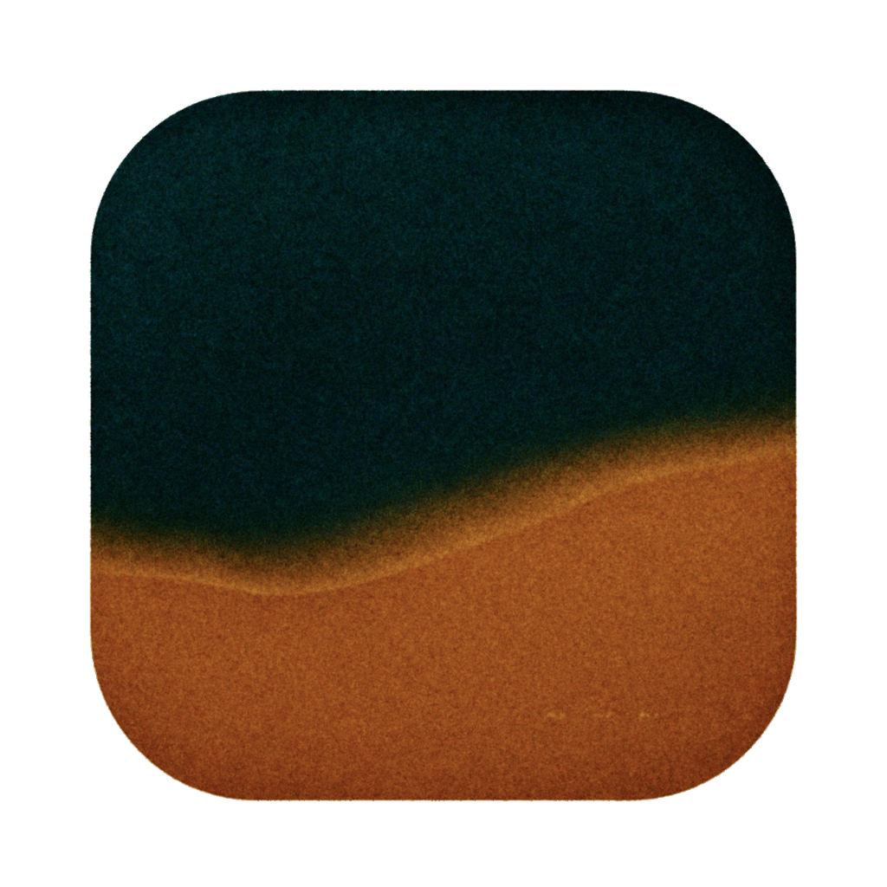

<p align="center">
  
</p>
<h1 align="center">FrameMatter</h1>

[English](README.md)

FrameMatter 是面向 macOS 的胶片与印放模拟应用，由 [LittleSixNine](https://github.com/LittleSixNine) 在 **Hanze Qiu** 的 [SpektraLab](https://github.com/JamesQiu2005/SpektraLab) 基础上独立开发；胶片成像模型来自 **Andrea Volpato** 的 [spektrafilm](https://github.com/andreavolpato/spektrafilm)。

上游提供了光谱胶片／印放流程、原生 C++/Metal 引擎、胶片和相纸配置、RAW 工作流、半格拼接、导出，以及 CLI／MCP 接口。FrameMatter 保留这些基础，增加颗粒、日期打印和胶片边缘外观的调节能力。

## FrameMatter 新增功能

- **颗粒调节**：开放强度、粒子面积与柔和度，沿用 spektrafilm 已有颗粒模型。
- **日期后背**：增加四种 DSEG7 LCD 字体，与原有点阵样式并存；扩展日期／时间格式，支持自设日期和时间，以及字段间距、大小和亮度调节。135 边距沿照片内容角落到中心的对角线移动，不包含片边。年月日时分秒仅支持片间打印；日时分支持冒号或参考样片式下划线。
- **划痕与灰尘**：增加齿孔摩擦划痕与齿孔边缘磨损。负片扫描灰尘使用 **112 份真实灰度素材：64 份尘粒、32 份短纤维、16 份长纤维**。可调数量、大小、强度和纤维比例，范围可选仅片边或全片；“换一组”更换已保存的随机样式，预览与导出沿用同一分布。
- **漏光**：独立的左栏选项卡提供贴孔细亮边与孔外柔晕。两种样式分别保存强度、扩散范围和随机图案，细亮边另有覆盖与柔化。漏光开关、随机种子独立于划痕和灰尘，旧版已采用的漏光参数会自动迁移。另有大范围漏光分组，支持六张本地素材、方向、侵入范围、大小与柔化，最高强度允许冲白；私人素材不进入 Git 或公开发布包。
- **135 全宽曝光**：在宽幅格式下增加 69.5 × 35 mm／6×7 模式，照片内容延伸到齿孔之间及外侧，边码叠在曝光画面上，齿孔保持镂空。
- **片边与界面**：支持白色或近黑色齿孔背景；左栏分组内的子设置标签缩进，层级更清楚。

这些外观效果是视觉模拟，不代表某款相机磨损或扫描仪的实测复现。日期后背不支持宽幅格式；划痕与灰尘需先开启 135、半格或全宽片边。

## 构建与测试

环境：Apple silicon、macOS 15 及以上、Xcode 26.6，并安装 Metal 工具链。在仓库根目录执行：

```bash
engine/build.sh bundle
python3 modern_UI/Spektrafilm/Tools/gen-project.py
xcodebuild -project modern_UI/Spektrafilm/Spektrafilm.xcodeproj \
  -scheme Spektrafilm -configuration Debug \
  -derivedDataPath modern_UI/Spektrafilm/build/DerivedData build
```

产物：`modern_UI/Spektrafilm/build/DerivedData/Build/Products/Debug/FrameMatter.app`。内部构建目标和模块仍叫 `Spektrafilm`；烘焙资源随仓库提供，运行应用无需 Python。为兼容已有编辑，原有本地设置和编辑文件存储路径继续沿用。

```bash
xcodebuild -project modern_UI/Spektrafilm/Spektrafilm.xcodeproj \
  -scheme SpektrafilmTests -configuration Debug \
  -derivedDataPath modern_UI/Spektrafilm/build/DerivedData test
```

部分测试依赖外部相机素材，缺少时会跳过；有跳过项目的通过结果不代表完整素材覆盖。实现说明见 [ARCHITECTURE.md](ARCHITECTURE.md) 和[前端说明](modern_UI/Spektrafilm/README.md)。

[发布页面](https://github.com/LittleSixNine/FrameMatter/releases) · [问题反馈](https://github.com/LittleSixNine/FrameMatter/issues) · [源码](https://github.com/LittleSixNine/FrameMatter)

FrameMatter 的构建独立于上游安装包，不继承上游的 Developer ID 签名或 Apple 公证。CLI／MCP 默认关闭，在“设置 → 智能体”开启；该面板提供 `framematter` 命令和当前 MCP 配置。

## 原作者与许可

| 部分 | 作者／来源 | 许可 |
|---|---|---|
| 原始应用、原生 C++/Metal 移植及四款黑白胶片配置 | [Hanze Qiu／SpektraLab](https://github.com/JamesQiu2005/SpektraLab) | GPL-3.0-or-later；配置数据保留其原始声明 |
| 胶片模型、实测彩色配置、印放 LUT | [Andrea Volpato／spektrafilm](https://github.com/andreavolpato/spektrafilm) | 代码 GPL-3.0-or-later；配置与 LUT 为 CC BY-SA 4.0 |
| FrameMatter 新增功能 | [LittleSixNine](https://github.com/LittleSixNine/FrameMatter) | GPL-3.0-or-later |
| 灰尘与纤维扫描素材 | [Daniela Ivanova／Scans of film damage](https://doi.org/10.6084/m9.figshare.21803292) | CC BY 4.0；裁切与提取修改记录随应用提供 |
| 划痕算法参考 | [FilmDamageSimulator](https://github.com/daniela997/FilmDamageSimulator) | MIT |
| DSEG 字体 | [Keshikan／DSEG](https://github.com/keshikan/DSEG) | SIL Open Font License 1.1 |
| Metal C++ 绑定 | Apple／metal-cpp | Apache-2.0 |

完整许可和源码链接见 **FrameMatter → About FrameMatter** 及源码中的许可文件。README 与应用统一使用 FrameMatter 图标。FrameMatter 是独立衍生项目，并非 SpektraLab 或 spektrafilm 的官方发布版本；完整 Git 历史与原作者署名均保留。
